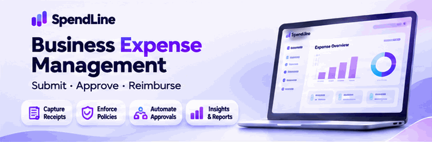
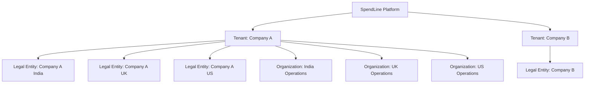
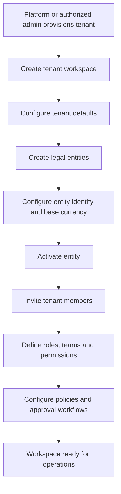
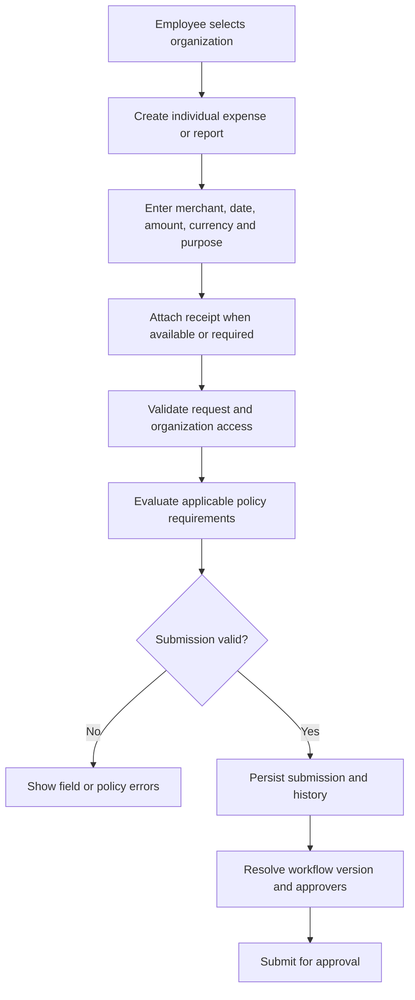
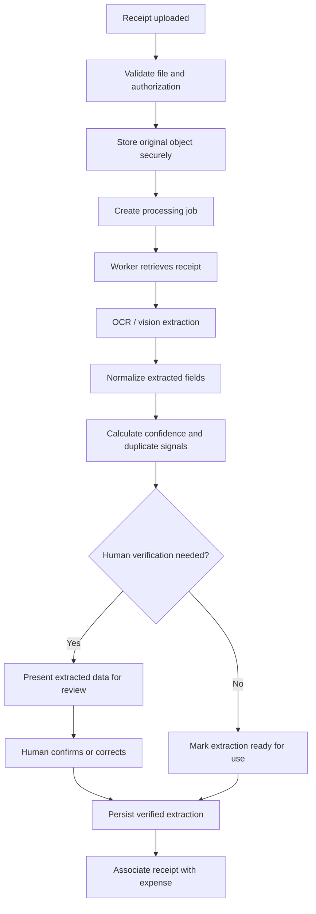
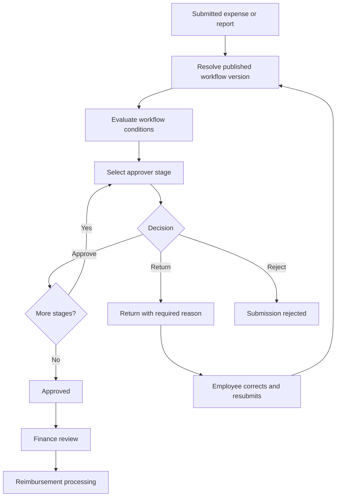
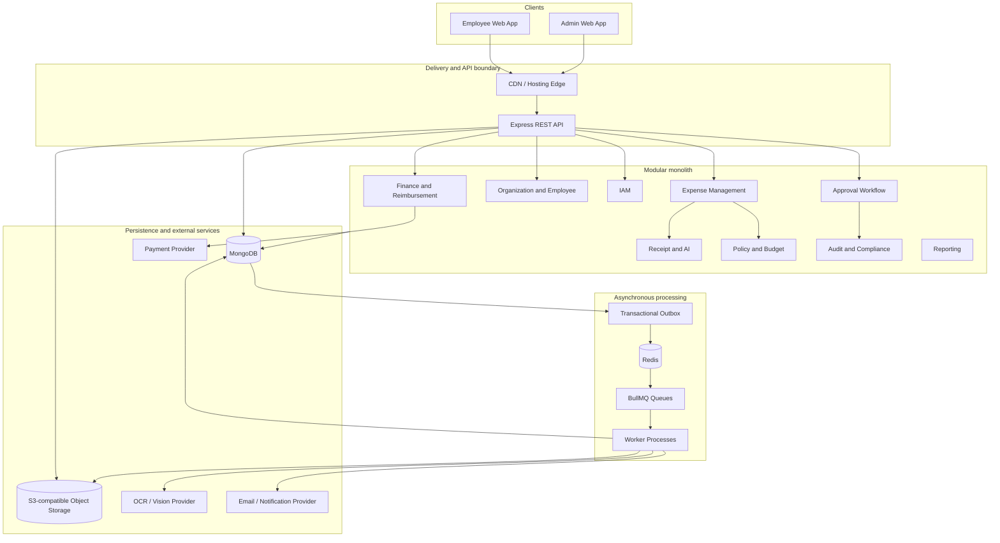
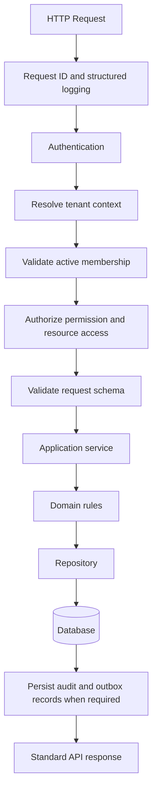
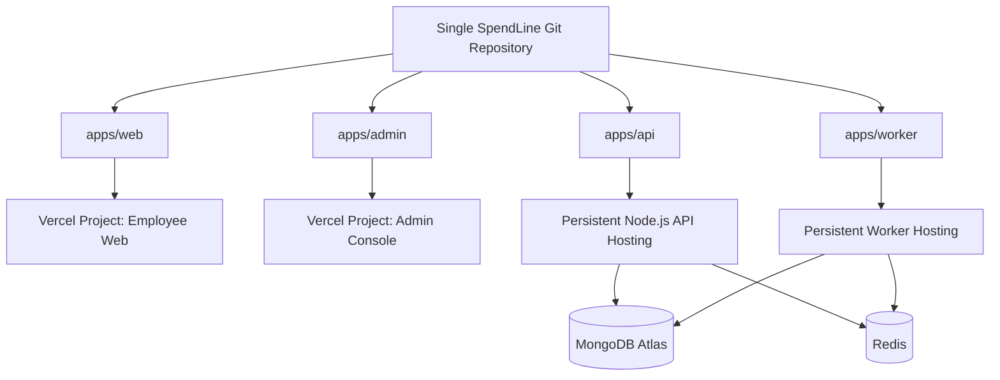

<p align="center">
  
</p>

# SpendLine

### Enterprise spend management, from expense capture to reimbursement.

**Submit · Review · Approve · Reimburse · Understand**

[](https://nodejs.org/)
[](https://www.typescriptlang.org/)
[](https://expressjs.com/)
[](https://nextjs.org/)
[](https://www.mongodb.com/)
[](https://redis.io/)

> **Project status:** Active development · Foundation phase\
> **Architecture:** Modular monolith with independently deployed
> applications and separate background workers
> :::

---

## Contents

- [1. Product overview](#1-product-overview)
- [2. Problem and product goals](#2-problem-and-product-goals)
- [3. Product scope and
  capabilities](#3-product-scope-and-capabilities)
- [4. Users and personas](#4-users-and-personas)
- [5. Tenant, organization and access
  model](#5-tenant-organization-and-access-model)
- [6. End-to-end business workflows](#6-end-to-end-business-workflows)
- [7. System architecture](#7-system-architecture)
- [8. Backend architecture and request
  lifecycle](#8-backend-architecture-and-request-lifecycle)
- [9. Domain module boundaries](#9-domain-module-boundaries)
- [10. Data architecture and
  integrity](#10-data-architecture-and-integrity)
- [11. Security and authorization](#11-security-and-authorization)
- [12. AI and asynchronous
  processing](#12-ai-and-asynchronous-processing)
- [13. Technology stack](#13-technology-stack)
- [14. Repository structure](#14-repository-structure)
- [15. API conventions](#15-api-conventions)
- [16. Testing strategy](#16-testing-strategy)
- [17. Deployment architecture](#17-deployment-architecture)
- [18. Observability and operations](#18-observability-and-operations)
- [19. Non-functional requirements](#19-non-functional-requirements)
- [20. Development roadmap](#20-development-roadmap)
- [21. Local development](#21-local-development)
- [22. Configuration reference](#22-configuration-reference)
- [23. Engineering principles and
  decisions](#23-engineering-principles-and-decisions)
- [24. Current implementation
  status](#24-current-implementation-status)
- [25. Contributing](#25-contributing)

---

## 1. Product overview

**SpendLine** is a multi-tenant business spend management platform
designed to help companies manage employee expenses, receipts, approval
workflows, policy compliance, budgets, reimbursements and financial
visibility.

The product is designed around a parent company workspace (**tenant**)
that can contain multiple legal entities and organizations. Employees
can have memberships in more than one organization, with
organization-specific roles, teams and reporting relationships.

SpendLine aims to provide a controlled, traceable expense lifecycle:

1.  An employee creates an expense or expense report.
2.  Receipts are attached and, where enabled, processed using OCR and
    AI-assisted extraction.
3.  The submission is checked against applicable policies.
4.  A configurable approval workflow routes it to authorized approvers.
5.  Finance reviews approved expenses and manages reimbursement.
6.  Every important action is retained in an auditable history.
7.  Authorized users can review operational and financial reports.

### Product vision

> Make business spending easier to submit, safer to approve, simpler to
> reimburse and clearer to understand.

### Product principles

- **Tenant isolation first:** tenant data must never leak across
  company boundaries.
- **Organization-aware access:** permissions are evaluated in the
  active organization context.
- **Financial traceability:** preserve original transaction facts and
  historical decisions.
- **Configurable workflows:** companies can adapt approval rules to
  their operating model.
- **Human accountability:** AI assists extraction and review; it does
  not silently make financial decisions.
- **Incremental architecture:** start with a modular monolith and
  extract services only when justified by evidence.

## 2. Problem and product goals

### Problems addressed

---

Problem SpendLine capability

---

Expense submissions arrive through Centralized expense and report
disconnected channels submission

Receipts are manually reviewed and Receipt storage and AI-assisted
re-entered extraction

Approval paths are unclear or Configurable approval workflows
inconsistent

Policy violations are discovered Policy checks during submission
late and review

Finance lacks reimbursement Finance review and reimbursement
visibility tracking

Multiple entities need separate Tenant and legal-entity model
financial context

Decisions are difficult to audit Append-only audit history

Financial reporting across Explicit FX conversion metadata
currencies is misleading and rules

---

### Product goals

- Provide a clear employee expense experience.
- Support configurable, multi-stage approval workflows.
- Give finance teams visibility into approved, payable and reimbursed
  expenses.
- Support multi-tenant companies with multiple legal entities.
- Maintain historical and audit integrity.
- Automate repetitive receipt-processing work without removing human
  oversight.
- Offer dependable APIs and independently deployable user interfaces.

### Out of scope for the initial foundation

The following are future product capabilities, not claims about the
current implementation:

- Corporate card issuing and transaction feeds.
- Full procurement and purchase-order management.
- Direct bank-account connectivity.
- Full accounting-system synchronization.
- Tax filing or tax advice.
- Autonomous AI approval of financial transactions.

## 3. Product scope and capabilities

Capabilities below describe the intended product scope. Implementation
status is tracked separately in [Current implementation
status](#24-current-implementation-status).

### Employee experience

- Join a tenant through invitation or an approved onboarding process.
- Access authorized organizations.
- Switch between eligible organization contexts.
- Create individual expenses.
- Group expenses into expense reports.
- Attach one or more receipts.
- Add participants from the same organization.
- View personal submission and approval history.
- Respond to returned submissions and resubmit corrections.
- Track reimbursement status.

### Manager and approver experience

- View submissions assigned to them.
- Review expense details and policy context.
- Approve, return for correction or reject.
- Provide reasons and comments where required.
- Delegate or escalate where workflow configuration permits.
- View prior decisions and workflow history.

### Finance experience

- Review approved expenses and reports.
- Apply finance controls and exception handling.
- Manage reimbursement readiness and payment records.
- Reconcile payment outcomes.
- Review entity and currency context.
- Access authorized exports and reports.

### Tenant administration

- Create and manage tenant settings.
- Manage legal entities and parent-subsidiary relationships.
- Invite and manage tenant members.
- Define tenant roles, permissions and teams.
- Configure organization availability and assignments.
- Configure expense categories, policies and workflows.
- Review audit events and tenant-level reporting.

### Platform administration

- Provision and support tenants.
- Manage platform-level roles and operational controls.
- Monitor service health, quotas and platform activity.
- Platform access is separate from tenant-level authorization.

## 4. Users and personas

A person may hold different roles in different organizations. Role names
alone do not grant access: every operation is checked against the active
tenant, organization, resource and permission.

---

Persona Primary responsibilities

---

Employee / Team Member Create expenses, submit reports,
attach receipts and track outcomes

Manager Review and decide on assigned
submissions

Organization Admin Manage authorized organization
membership, teams and organization
settings

Finance Admin Review financial submissions,
reimbursement and finance
operations

Tenant Admin Manage tenant-wide members, roles,
settings and organization
configuration

Tenant Owner Own the tenant workspace and
high-level administration

Platform Support / Operations Perform explicitly authorized
platform support activities

Super Admin Platform-level administration
under controlled access

---

### Access principles

- A user's access to one organization does not imply access to
  another.
- A manager must have an active membership in the organization where
  they manage people.
- Being a participant on an expense does not automatically grant edit
  or approval rights.
- Role assignment does not automatically confer approval authority.
- Platform roles and tenant roles are distinct.
- Removing an active membership must not erase historical expense or
  approval records.

## 5. Tenant, organization and access model

### Hierarchy



**Tenant** is the company workspace and central authority for members,
tenant role definitions, team definitions and tenant-wide settings.

**Legal entity** represents a registered legal organization within a
tenant. Each legal entity belongs to exactly one tenant and has its own
legal identity and base currency. A legal entity may have at most one
direct parent. Hierarchy changes must not create cycles or cross-tenant
parent relationships.

**Organization** is the access and operating context in which
organization membership, roles, teams and reporting relationships are
evaluated. The product model keeps organization membership distinct from
legal-entity identity.

### Member and organization membership

- A tenant member is created once in the tenant directory.
- A tenant member may have memberships in multiple organizations.
- Organization memberships have their own lifecycle.
- An Organization Admin inviting a member initially assigns them only
  to their authorized organization.
- A Tenant Admin may assign a member to any organization they are
  authorized to administer.
- Additional organization access requires a separate authorized
  action.
- Suspending a tenant member blocks access across that tenant.
- Suspending or removing an organization membership affects only that
  organization.
- Rejoining an organization creates a new active membership period
  while preserving prior history.

### Lifecycle states

**Tenant member:** `INVITED`, `ACTIVE`, `SUSPENDED`, `DEACTIVATED`

**Organization membership:** `INVITED`, `ACTIVE`, `SUSPENDED`, `REMOVED`

### Roles and teams

- Role definitions are managed centrally by the tenant.
- A role may be shared across organizations or restricted to a
  designated organization.
- Teams are defined centrally and can be shared or
  organization-restricted.
- A member can belong to multiple teams in the same organization.
- Reporting relationships are organization-specific.
- A member may have different managers in different organizations.
- Role assignment and approval authority remain separate concepts.
- Role assignment policies may limit a role to one organization,
  multiple organizations or unrestricted assignments.

### Organization and legal-entity lifecycle

Legal entities support controlled lifecycle transitions:

`DRAFT → ACTIVE ↔ SUSPENDED → ARCHIVED`

An archived entity remains available for authorized historical
reporting. Financial history must not be erased by ordinary deletion.
Changing a base currency after financial transactions exist requires a
controlled migration. Consolidated reporting across currencies requires
a documented FX source, effective date and rounding policy.

## 6. End-to-end business workflows

### 6.1 Tenant onboarding



### 6.2 Employee onboarding

1.  An authorized tenant or organization administrator invites a person.
2.  The invitation is associated with a tenant and the authorized
    initial organization assignment.
3.  The invitee completes the supported identity-verification and
    account setup flow.
4.  IAM establishes the identity, credentials and session.
5.  Employee/Organization functionality maintains the member directory
    and organization membership.
6.  The user can access only active, authorized organization contexts.
7.  Additional organization memberships require a separately authorized
    assignment.

### 6.3 Expense submission



Expense and report rules:

- Every expense belongs to a tenant, organization and primary
  submitter.
- An expense records its original amount, currency, date, category and
  business purpose.
- A report contains expenses from one organization and one primary
  submitter.
- An expense cannot belong to multiple active reports.
- Individual expense submission and grouped expense reports are both
  supported by the product design.
- Submitted records are locked against direct editing.
- A returned submission may be corrected and resubmitted, preserving
  prior decisions and comments.
- A rejection ends the current submission.
- Cancellation requires an authorized actor and a reason.
- Approved or paid reports are not ordinarily cancelled;
  finance-controlled reversal is required.

### 6.4 Receipt and AI processing



AI extraction is assistive:

- Original receipt files are preserved.
- Extracted data is not allowed to silently overwrite user-entered
  values.
- Low-confidence or conflicting fields can be routed for human review.
- Duplicate detection creates a review signal, not an automatic fraud
  conclusion.
- Receipt retention and deletion follow configured policy and legal
  requirements.

### 6.5 Approval workflow



Workflow capabilities are intended to support:

- Single-stage and multi-stage approvals.
- Sequential and parallel stages.
- Conditional routing based on organization, amount, category,
  submitter role and other configured criteria.
- Delegation and escalation under explicit policy.
- Required decision reasons for return and other controlled actions.
- Workflow version capture at submission time.
- Historical decisions that remain unchanged when future workflow
  definitions are edited.

No fixed Manager → Finance sequence is assumed for every company. The
configured workflow determines the actual path.

### 6.6 Finance and reimbursement

1.  An approved expense or report becomes eligible for finance review.
2.  Finance validates the required financial information and policy
    exceptions.
3.  Eligible amounts are prepared for reimbursement.
4.  A payment instruction or payable record is created with idempotency
    protection.
5.  The payment integration executes or records the payment outcome.
6.  Webhooks and reconciliation update payment state safely.
7.  The reimbursement and its audit history remain available for
    reporting.

Payment provider integration, bank connectivity and accounting
synchronization are planned capabilities and must be implemented and
verified independently.

## 7. System architecture

### Architectural style

SpendLine starts as a **modular monolith** with separate application
entry points and independently deployed background worker processes.

This provides:

- Clear domain boundaries without premature distributed-system
  complexity.
- One repository and coordinated code review.
- Independent application builds and deployments.
- Explicit ownership of domain data.
- A path to extract services later if scale, ownership or reliability
  requirements justify it.

A modular monolith is not a single unstructured codebase. Modules must
communicate through defined application interfaces and domain events
rather than reaching into each other's internal models.

### High-level architecture



### Application boundaries

---

Application Responsibility Intended deployment

---

`apps/api` REST API, Persistent Node.js
authentication boundary hosting
and domain application  
 services

`apps/web` Employee-facing Next.js Separate Vercel project
application

`apps/admin` Tenant and platform Separate Vercel project
administration UI

`apps/worker` Asynchronous jobs and Persistent worker
event processing hosting

---

The API and worker are separate processes. They may use the same
repository and domain modules while having different runtime entry
points and scaling policies.

## 8. Backend architecture and request lifecycle

### Request lifecycle



The actual middleware chain will be implemented in this order as the
security and infrastructure phases are completed. The current API
foundation has only the pieces explicitly listed in [Current
implementation status](#24-current-implementation-status).

### Layer responsibilities

---

Layer Responsibility

---

Routes HTTP method, path and middleware
composition

Middleware Authentication, request context,
validation and cross-cutting
concerns

Application services Coordinate use cases and
transaction boundaries

Domain logic Enforce business invariants

Repositories Own persistence operations for a
module

Infrastructure Database, queue, storage, provider
and logging adapters

Workers Execute asynchronous jobs and
retryable tasks

---

### Module boundaries

- A module owns its domain rules, application services and persistence
  models.
- Other modules must not directly query or mutate another module's
  models.
- Cross-module operations use explicit interfaces or domain events.
- Events that must not be lost are recorded using a transactional
  outbox pattern.
- Shared technical infrastructure should not become a dumping ground
  for business logic.

## 9. Domain module boundaries

---

Module Owns Does not own

---

IAM Identity, credentials, Employee profile,
sessions, MFA, roles, expense decisions,
permissions, payment records
memberships and  
 security events

Organization Tenant profile, legal Authentication
entities, hierarchy and credentials
tenant/entity settings

Employee Member directory, Passwords, tokens and
organization permission enforcement
assignments, teams and  
 reporting relationships

Expense Expenses, reports, Receipt binary
participants, processing, approval
submission lifecycle workflow definitions
and expense-to-receipt  
 association

Receipt and AI Receipt files, OCR, Expense approval
extraction, confidence, decisions
verification and  
 duplicate signals

Approval Workflow Workflow definitions, Expense policy
stages, conditions, definitions
approver resolution and
decisions

Policy and Budget Expense rules, category Authentication
rules, budgets, cost  
 centers and policy  
 exceptions

Finance Finance review, payable Payment provider
and reimbursement transport
records, reconciliation

Payment Payment execution, Expense ownership
provider adapters,  
 webhooks and payment  
 state transitions

Audit and Compliance Append-only business Domain ownership of
activity history and business records
compliance evidence

Notifications Notification Business approval
preferences, delivery decisions
attempts and provider  
 dispatch

Integrations External provider Ownership of
adapters and source-domain records
synchronization

Reporting Authorized projections, Unauthorized direct
summaries and exports access to module
internals

Platform Administration Tenant provisioning, Tenant business
plans, quotas and workflows
platform operations

---

### Expense data principles

An expense is associated with:

- Tenant.
- Organization.
- Primary submitter.
- Merchant and expense date.
- Original amount and currency.
- Category and business purpose.
- Receipt references.
- Optional participants and business references.
- Submission and lifecycle history.

Participants must belong to the same organization. Participant
visibility is limited by default; they do not automatically gain edit,
approval, receipt or private-comment access.

### Multi-currency principles

- Preserve the original amount and currency.
- Record the applicable entity base currency.
- Store converted values separately.
- Preserve exchange rate, source, effective date and rounding details.
- Never overwrite the original transaction amount.
- Never sum amounts in unlike currencies without an explicit
  conversion policy.

## 10. Data architecture and integrity

### Persistence strategy

**MongoDB Atlas + Mongoose** is the planned primary data store.

MongoDB collections will be owned by domain modules. Data modeling will
use:

- Explicit tenant and organization references.
- Unique indexes for tenant-scoped identifiers.
- Partial unique indexes where optional external identifiers require
  uniqueness.
- Controlled lifecycle state transitions.
- References or embedded data based on access patterns and consistency
  needs.
- Explicit schema validation and indexes.

### Tenant isolation

Every tenant-owned record must be scoped to a validated tenant context.
The tenant identifier must be derived from authenticated server-side
context, never trusted directly from a request body.

Every organization-scoped operation must also verify the user's active
organization membership and resource access.

### Financial integrity

- Use safe monetary representations and explicit currency metadata.
- Avoid binary floating-point arithmetic for financial calculations.
- Use idempotency keys for retryable financial operations.
- Preserve transaction and decision history.
- Use controlled state transitions.
- Protect against concurrent updates with versioning or conditional
  writes where appropriate.
- Keep payment and reimbursement records reconcilable.

### Transactional outbox

When a business operation must update domain state and publish an event,
the domain update and outbox record should be committed together. A
background publisher delivers outbox events and marks them processed.
Consumers must be idempotent because delivery can be repeated.

## 11. Security and authorization

### Authentication

Planned capabilities:

- Email and password authentication.
- Email verification.
- Password reset.
- Access and refresh token lifecycle.
- Refresh token rotation and session revocation.
- Multi-factor authentication.
- Google and Microsoft SSO readiness.
- Tenant-aware sign-in and organization selection.
- Login throttling and account protection.

### Authorization

SpendLine uses permission-based RBAC with resource-level checks.

Authorization should consider:

1.  Authenticated identity.
2.  Active tenant membership.
3.  Selected organization context.
4.  Permission granted by role assignment.
5.  Resource ownership or authorized relationship.
6.  Resource lifecycle and operation-specific rules.

Multiple roles may be assigned in an organization according to role
assignment policy. Permission composition must not create privilege
escalation.

### Security controls

Planned controls include:

- TLS in deployed environments.
- Secure password hashing.
- Short-lived access tokens and refresh-token rotation.
- Secure cookie strategy where applicable.
- Rate limiting and abuse protection.
- CORS allowlists.
- Security headers.
- Request schema validation.
- Safe error responses.
- Secret management through deployment environments.
- Audit of sensitive administrative and financial actions.
- Receipt file validation, private storage and short-lived access
  links.
- Least-privilege service credentials.

## 12. AI and asynchronous processing

### Background processing

Long-running or retryable tasks should not block HTTP request
processing.

Planned queue use cases:

- Receipt OCR and extraction.
- Notifications.
- Payment execution and reconciliation.
- Report generation and exports.
- Outbox event delivery.

**Redis + BullMQ** is the planned queue technology.

### Job reliability

Workers should implement:

- Idempotent job handlers.
- Bounded retries and exponential backoff where appropriate.
- Dead-letter or failed-job inspection.
- Job correlation identifiers.
- Timeout and concurrency controls.
- Graceful shutdown and safe job completion.
- Metrics for queue depth, failures and processing latency.

### AI safety and control

- AI extraction is a suggestion, not a source of truth.
- Confidence and extraction provenance are retained.
- Human verification is available for uncertain fields.
- Original receipts are preserved.
- Duplicate detection is a signal for review, not a fraud verdict.
- AI must not approve expenses or initiate payments without explicit,
  separately authorized business rules.

## 13. Technology stack

The following distinguishes the selected architecture from technologies
that are planned for later implementation.

---

Area Technology Status

---

Runtime Node.js 24 LTS In use

Language TypeScript In use

Backend framework Express Foundation in progress

Module system Node.js ESM / Configured
`NodeNext`

Package management npm workspaces In use

Frontend Next.js + React Planned

Styling Tailwind CSS Planned

Primary database MongoDB Atlas Planned

ODM Mongoose Planned

Cache and queue backend Redis / Upstash Planned

Job queue BullMQ Planned

Validation Zod In use

Local environment dotenv In use
loading

Development TS tsx In use
execution

Unit testing Node.js `node:test` and In use
`node:assert/strict`

HTTP integration Supertest In use
testing

API documentation OpenAPI Planned

Object storage S3-compatible storage Planned

OCR / AI OCR and vision-capable Planned
model provider

Employee/Admin hosting Vercel, separate Planned
projects

API/Worker hosting Persistent Node.js To be selected
hosting

CI/CD Git-based pipelines Planned

Observability Structured logs, Foundation started
metrics and tracing

---

Versions should be pinned and maintained in the relevant application
manifests and lockfile. The badges above are architectural indicators,
not a substitute for checking installed package versions.

## 14. Repository structure

SpendLine uses **one Git repository** with independent applications.
There is intentionally no shared `packages/` directory.

```text
spendline/
├── apps/
│   ├── api/
│   │   ├── src/
│   │   │   ├── config/
│   │   │   ├── middleware/
│   │   │   ├── modules/
│   │   │   ├── utils/
│   │   │   ├── app.ts
│   │   │   └── server.ts
│   │   ├── tests/
│   │   ├── package.json
│   │   ├── tsconfig.json
│   │   └── tsconfig.test.json
│   ├── web/
│   │   └── package.json
│   ├── admin/
│   │   └── package.json
│   └── worker/
│       └── package.json
├── infrastructure/
├── docs/
├── .gitignore
├── package.json
└── package-lock.json
```

Each application owns its own:

- `package.json`
- Runtime and development dependencies.
- TypeScript and build configuration where applicable.
- Scripts.
- Tests.
- Deployment settings.

npm may hoist compatible dependencies into the root `node_modules`
directory. Physical hoisting does not change dependency ownership: each
application must declare the dependencies it uses.

### Workspace commands

Run commands from the repository root:

```bash
# List workspace applications
npm ls --workspaces --depth=0

# Run an application script
npm run dev --workspace=@spendline/api

# Build the API
npm run build --workspace=@spendline/api

# Type-check the API
npm run typecheck --workspace=@spendline/api

# Run API tests
npm run test --workspace=@spendline/api
```

## 15. API conventions

### REST conventions

- Use nouns for resources.
- Use HTTP methods according to operation semantics.
- Version public APIs when compatibility requirements justify it.
- Validate path parameters, query parameters and request bodies.
- Keep business logic out of route handlers.
- Return appropriate HTTP status codes.
- Include a request identifier in responses.

Example future route layout:

```text
/api/v1/auth
/api/v1/tenants
/api/v1/organizations
/api/v1/members
/api/v1/expenses
/api/v1/expense-reports
/api/v1/receipts
/api/v1/approvals
/api/v1/policies
/api/v1/reimbursements
/api/v1/reports
```

### Success response

```json
{
  "success": true,
  "message": "Expense created successfully",
  "data": {
    "id": "expense-id",
    "title": "Flight ticket"
  },
  "requestId": "request-id"
}
```

### Error response

```json
{
  "success": false,
  "error": {
    "code": "VALIDATION_ERROR",
    "message": "Request validation failed",
    "details": [
      {
        "field": "amount",
        "message": "Amount must be greater than zero"
      }
    ],
    "requestId": "request-id"
  }
}
```

### Status code conventions

Status Meaning

---

200 Successful read or update
201 Resource created
202 Accepted for asynchronous processing
204 Successful operation with no response body
400 Invalid request
401 Authentication required or invalid
403 Authenticated but not authorized
404 Resource not found
409 State conflict or duplicate operation
422 Semantically invalid operation, where used by API policy
429 Rate limit exceeded
500 Unexpected server failure
503 Service temporarily unavailable

### Pagination

List endpoints should use a consistent pagination contract. Example:

```json
{
  "success": true,
  "message": "Expenses retrieved successfully",
  "data": [],
  "pagination": {
    "page": 1,
    "limit": 20,
    "total": 120,
    "totalPages": 6
  },
  "requestId": "request-id"
}
```

The exact pagination strategy (offset or cursor) should be selected
based on the query and expected data volume.

## 16. Testing strategy

Testing is part of the design, not a final-stage activity.

### Test layers

---

Layer Scope Examples

---

Unit Isolated logic AppError, policy
calculation, currency
helpers

Integration Components working Express routes,
together middleware,
repositories

Authorization Access control Cross-tenant and
cross-organization
denial

Contract API compatibility Request and response
schema expectations

Worker Background processing Retries, idempotency
and failure recovery

End-to-end Complete user journeys Expense submission
through reimbursement

Performance Load and latency High-volume expense
listing and submissions

---

### Current API tests

The initial API foundation includes:

- AppError property tests.
- Operational and non-operational error tests.
- Structured error detail tests.
- Health endpoint response tests.
- Request ID header and body propagation tests.
- Valid expense request tests.
- Invalid expense request tests.
- Unknown route tests.

### Future quality gates

Before a change is considered complete:

1.  Type-check the affected application.
2.  Run relevant unit tests.
3.  Run integration tests.
4.  Add authorization and tenant-isolation tests for protected routes.
5.  Build the application.
6.  Review logs and error behavior.
7.  Update API and architecture documentation where necessary.

## 17. Deployment architecture

### One repository, separate deployment pipelines



### Vercel projects

Two independent Vercel projects are planned:

Project Root directory Purpose

---

SpendLine Web `apps/web` Employee experience
SpendLine Admin `apps/admin` Tenant administration

Each project has its own:

- Build and deployment settings.
- Environment variables.
- Domains and previews.
- Production deployment controls.

Changes to one application should not unnecessarily trigger deployments
of the other. Configure the repository's deployment filters and project
root directories accordingly.

### API and worker hosting

The Express API and BullMQ worker require hosting appropriate for
persistent Node.js processes and their runtime characteristics. They
should not be assumed to be Vercel deployments. The provider will be
selected after infrastructure requirements, health checks, graceful
shutdown and operational needs are evaluated.

### Environment separation

Maintain separate configuration and credentials for:

- Local development.
- Test.
- Staging.
- Production.

Never commit secrets or production credentials.

## 18. Observability and operations

### Logging

Logs should be structured and include relevant correlation fields:

- Timestamp.
- Severity.
- Message.
- Request or job ID.
- Tenant and organization identifiers where safe and appropriate.
- Module and operation.
- Error classification.

Do not log passwords, access tokens, refresh tokens, receipt contents or
unnecessary personal and financial data.

### Health checks

Two distinct concepts are planned:

- **Liveness:** the process is running and able to respond.
- **Readiness:** required dependencies are available and the process
  can safely accept work.

A successful liveness check must not be interpreted as proof that
MongoDB, Redis or every external provider is healthy.

### Metrics and tracing

Planned operational measurements include:

- Request count, error rate and latency.
- Database connection health and query latency.
- Queue depth, job duration and failure count.
- Payment and webhook processing outcomes.
- Receipt extraction duration and confidence distributions.
- Worker availability and restart behavior.

## 19. Non-functional requirements

The following are engineering targets and design requirements. Numerical
service-level objectives should be established after workload and
deployment measurements, not invented in advance.

---

Area Requirement

---

Security Tenant and organization isolation
on every protected operation

Reliability Safe retries, idempotency and
controlled failure handling

Integrity Financial history and original
transaction facts are preserved

Performance Pagination, indexes and measured
query optimization

Scalability Stateless API instances and
separately scalable workers

Maintainability Clear module ownership and
documented interfaces

Testability Unit, integration, authorization
and end-to-end coverage

Observability Correlated logs, metrics, health
checks and traceability

Accessibility Keyboard-accessible and
screen-reader-friendly interfaces

Recovery Backups, restore procedures and
operational runbooks

Compliance readiness Retention, audit and access
controls designed for applicable
requirements

---

## 20. Development roadmap

The project is developed in phases. A phase is considered complete only
when its implementation, tests and documentation meet the phase exit
criteria.

---

Phase Scope Exit criteria

---

1\. Repository and API Workspaces, TypeScript, Reliable API foundation
foundation Express, config, and repeatable checks
errors, validation,  
 responses and tests

2\. Backend MongoDB, Mongoose, Verified dependency
infrastructure Redis, BullMQ, startup, lifecycle and
shutdown and readiness infrastructure tests

3\. Security foundation Authentication, Authentication and
sessions, JWT authorization tests,
lifecycle, tenant including isolation
context, RBAC and  
 security middleware

4\. Organization and Tenant, legal entities, Organization and
workforce members, teams, roles membership lifecycle
and reporting structure tests

5\. Expense management Expenses, reports, End-to-end expense
participants, creation and submission
categories and  
 lifecycle

6\. Receipt and AI Upload, object storage, Secure receipt
OCR, extraction, processing with retry
verification and and review paths
duplicate signals

7\. Approval workflows Configurable stages, Versioned approval
conditions, decisions, workflow tests
delegation and  
 escalation

8\. Policy and budgets Policy rules, limits, Policy evaluation and
cost centers, budgets exception tests
and exceptions

9\. Finance and Finance review, Idempotent payment and
payments reimbursement, payment reconciliation tests
integration and  
 reconciliation

10\. Audit and Append-only history, Auditable operations
notifications in-app/email delivery and reliable delivery
and integrations

11\. Frontend Employee web and admin Complete primary user
applications console journeys

12\. Reporting and Dashboards, exports and Correctly scoped
analytics authorized reporting reports and export
projections tests

13\. Enterprise CI/CD, monitoring, Production-readiness
hardening performance, security, review
backup and recovery

---

### Phase 1 detailed checklist

- [x] Initialize Git repository.
- [x] Create independent npm workspaces.
- [x] Establish root `.gitignore`.
- [x] Configure API TypeScript.
- [x] Add TypeScript build and development execution.
- [x] Separate Express application and server entry point.
- [x] Add environment loading and validation foundation.
- [x] Add structured logging.
- [x] Add request ID middleware.
- [x] Add custom application errors.
- [x] Add centralized error handling.
- [x] Add not-found handling.
- [x] Add Zod request validation.
- [x] Add field-level validation error details.
- [x] Add a generic success response helper.
- [x] Add Node.js unit tests.
- [x] Add Supertest integration tests.
- [ ] Complete malformed JSON and unexpected-error test cases.
- [ ] Add coverage reporting and final foundation review.
- [ ] Remove temporary test-only endpoints before domain
      implementation.

## 21. Local development

### Prerequisites

- Node.js 24 LTS (or a compatible supported Node.js release).
- npm.
- Git.
- MongoDB Atlas account when database integration begins.
- Redis/Upstash account when queue integration begins.

### Clone and install

```bash
git clone <your-spendline-repository-url>
cd spendline
npm install
```

### Install workspace dependencies

Install dependencies in the application that owns them:

```bash
npm install <package> --workspace=@spendline/api
npm install -D <package> --workspace=@spendline/api
```

Do not add application dependencies to the root merely for convenience.

### API commands

```bash
# Run API in development watch mode
npm run dev --workspace=@spendline/api

# Type-check API source
npm run typecheck --workspace=@spendline/api

# Type-check API and test source
npm run typecheck:test --workspace=@spendline/api

# Build API
npm run build --workspace=@spendline/api

# Run API tests
npm run test --workspace=@spendline/api

# Run compiled API
npm run start --workspace=@spendline/api
```

### Current API smoke test

When the API is running:

```bash
curl -i http://localhost:3000/health
```

The health endpoint currently serves as a basic process-level check.
Dependency readiness will be introduced with infrastructure integration.

### Local environment files

Create `apps/api/.env` locally. Keep it out of Git.

An `.env.example` file should document variable names and safe
placeholders. Never include actual credentials.

## 22. Configuration reference

The API currently validates its basic runtime configuration. Additional
settings will become required as their integrations are implemented.

---

Variable Purpose Stage

---

`NODE_ENV` Runtime environment Current foundation

`PORT` HTTP server port Current foundation

`MONGO_URI` MongoDB connection Database phase
string

`REDIS_URL` Redis connection string Queue phase

`JWT_ACCESS_SECRET` Access token signing Security phase
secret

`JWT_REFRESH_SECRET` Refresh token/session Security phase
secret

`OBJECT_STORAGE_*` Object storage Receipt phase
configuration

`AI_PROVIDER_*` OCR/AI provider Receipt phase
configuration

`PAYMENT_PROVIDER_*` Payment provider Payment phase
configuration

---

The exact names and validation rules will be finalized when each
integration is implemented. Secrets must be stored in the deployment
platform's secret manager or environment configuration, not in source
control.

## 23. Engineering principles and decisions

### Architecture decisions

1.  One Git repository, multiple independent applications.
2.  npm workspaces manage application packages.
3.  No shared `packages/` directory is part of the current repository
    design.
4.  Employee Web and Admin are separate Vercel projects.
5.  API and worker are separately deployed processes.
6.  Backend starts as a modular monolith.
7.  Each domain module owns its data and business rules.
8.  Cross-module communication uses explicit interfaces and events.
9.  Tenant context is derived from authenticated server-side state.
10. Financial history is preserved and corrected through controlled
    workflows, not destructive edits.

### Decision principles

- Prefer the simplest architecture that satisfies measured
  requirements.
- Do not introduce microservices before operational or organizational
  needs justify them.
- Do not add dependencies without a clear capability or maintenance
  benefit.
- Do not treat frontend validation as a security boundary.
- Do not trust client-supplied tenant or organization identifiers
  without authorization checks.
- Do not silently overwrite financial values or AI-extracted data.
- Do not assume retries are safe unless operations are idempotent.
- Do not report a feature as implemented until it is built and tested.

## 24. Current implementation status

This README describes both the product specification and the
implementation roadmap. The following table separates what has been
built from what remains planned.

### Implemented in the current API foundation

- [x] npm monorepo with independent `api`, `web`, `admin` and `worker`
      workspaces.
- [x] API TypeScript configuration using NodeNext/ESM.
- [x] API development execution with `tsx`.
- [x] Express application and server entry point.
- [x] Environment loading and basic Zod validation.
- [x] Structured logger.
- [x] Request ID middleware.
- [x] Custom `AppError`.
- [x] Centralized error handler.
- [x] Not-found middleware.
- [x] Reusable Zod request validation middleware.
- [x] Field-level validation details.
- [x] Standard success response helper.
- [x] Node.js unit test foundation.
- [x] Supertest integration test foundation.
- [x] Initial AppError and HTTP integration tests.

### Not yet implemented

- [ ] MongoDB connection and Mongoose models.
- [ ] Redis connection and BullMQ queues.
- [ ] Authentication and authorization.
- [ ] Tenant and organization persistence.
- [ ] Expense and approval domain modules.
- [ ] Receipt storage and AI processing.
- [ ] Payment and reimbursement integration.
- [ ] Employee and Admin Next.js applications.
- [ ] Worker job implementations.
- [ ] Production deployment pipelines.
- [ ] Complete monitoring, backup and recovery operations.

### Current development status

The API foundation is under active development. The initial unit and
HTTP integration test suite has been exercised successfully. Additional
malformed-request, unexpected-error, coverage and lifecycle tests remain
part of the foundation hardening work.

## 25. Contributing

SpendLine is being developed incrementally with an emphasis on learning,
correctness and maintainability.

### Contribution expectations

- Keep changes within the owning application or domain module.
- Follow established TypeScript and naming conventions.
- Validate untrusted input at API boundaries.
- Add tests for new behavior and regression fixes.
- Preserve tenant and organization isolation.
- Never commit secrets, credentials or private receipt files.
- Update documentation when architecture or API contracts change.
- Keep pull requests focused and explain the reasoning behind
  architectural changes.

### Suggested commit conventions

```text
feat(api): add expense submission endpoint
fix(iam): prevent cross-tenant membership access
test(expense): cover report submission lifecycle
docs(architecture): document approval workflow
chore(api): update TypeScript configuration
```

---

::: {align="center"}

### SpendLine

**Better expense experiences. Clearer financial control.**

Built with deliberate engineering, one reliable capability at a time.
:::
